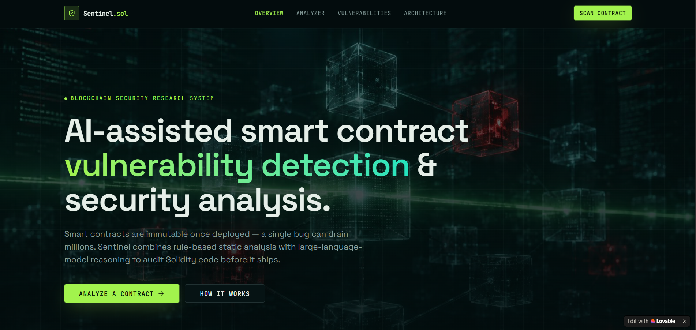
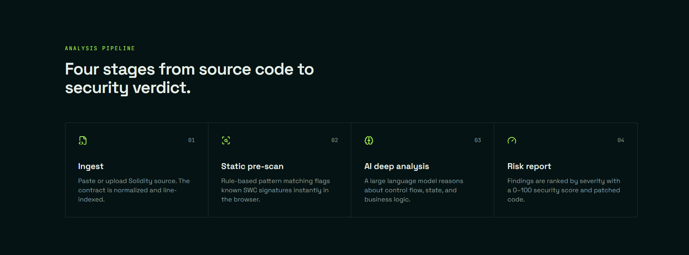
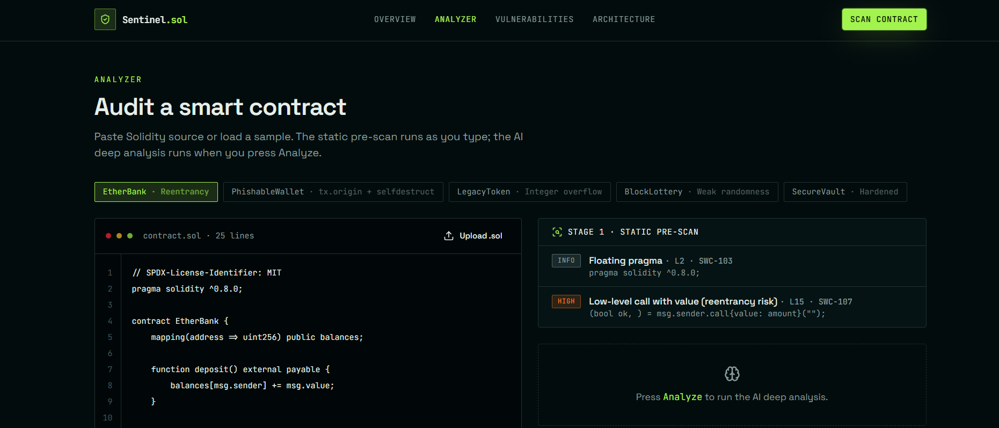
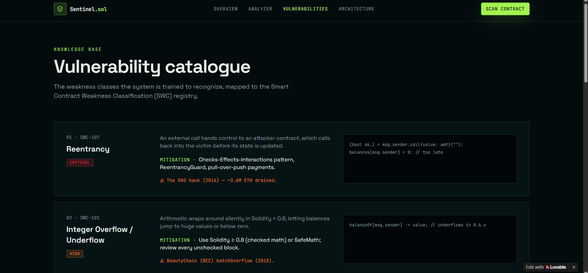
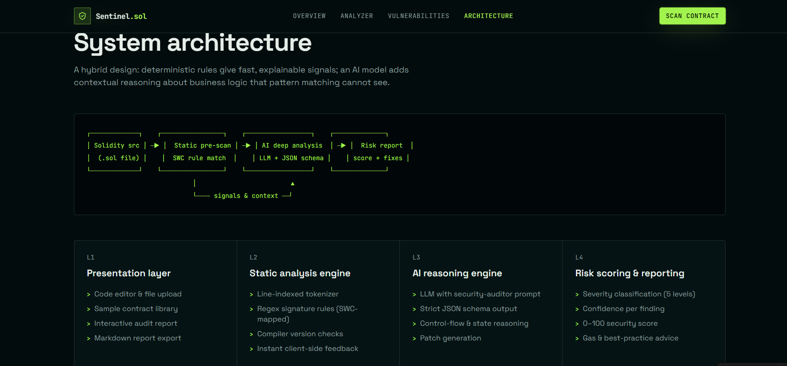

🛡️ Sentinel.sol
AI-Assisted Smart Contract Vulnerability Detection and Security Analysis

  <strong>Enhancing Blockchain Security Through AI-Assisted Analysis</strong>

  <a href="https://chaincode-guardian-ai.lovable.app">🌐 Live Demo</a>

---

 📌 About the Project

Sentinel.sol is an AI-assisted smart contract vulnerability detection and security analysis system designed to identify potential security weaknesses in Solidity smart contracts.

Smart contracts are widely used in blockchain applications such as cryptocurrencies, Decentralized Finance (DeFi), and NFT marketplaces. However, vulnerabilities in their code can be exploited by attackers, resulting in financial losses.

To address this challenge, Sentinel.sol combines rule-based static analysis with Large Language Model (LLM)-assisted reasoning to help identify potential vulnerabilities, analyze code logic, and suggest possible security improvements.

 🎯 Objectives

- Identify potential vulnerabilities in smart contract source code.
- Combine static analysis with AI-assisted code analysis.
- Classify detected vulnerabilities based on severity.
- Generate security reports with recommended fixes.
- Improve the security and reliability of blockchain applications.

 ⚙️ Methodology

The system follows four major stages:

 1. Input Collection (Ingest)
Users can paste or upload Solidity smart contract source code for analysis. The system normalizes the code and assigns line numbers.

 2. Static Pre-Scan
A rule-based analysis engine checks the source code for known vulnerability patterns using SWC-mapped rules.

 3. AI Deep Analysis
A Large Language Model (LLM) assists in examining code logic, control flow, contract state, and business logic to identify potential security weaknesses.

 4. Risk Report Generation
The system presents detected findings with severity levels, a security score out of 100, and suggested patched code.

🔍 Vulnerabilities Covered

The system's vulnerability catalogue includes common smart contract weaknesses such as:

- Reentrancy
- Integer Overflow and Underflow
- Access Control Issues
- Denial of Service
- Timestamp Dependency
- Weak Randomness
- Other smart contract security weaknesses

🛠️ Technology Stack

- React
- TypeScript
- Solidity
- TanStack Router
- Tailwind CSS
- Lucide React
- Static Code Analysis
- Large Language Models (LLMs)

 📸 Project Screenshots

 1. Homepage

 2. Analysis Pipeline

 3. Smart Contract Analyzer

 4. Vulnerability Catalogue

 5. System Architecture

 💡 Applications

- Cryptocurrency Platforms
- Decentralized Finance (DeFi) Systems
- NFT Marketplaces
- Blockchain-Based Business Applications

🚀 Future Scope

- Support for multiple blockchain platforms.
- Detection of emerging security attack patterns.
- Real-time smart contract security monitoring.
- Improved AI analysis and detection accuracy.

⚠️ Disclaimer

This project is developed for educational and research purposes. AI-assisted security analysis does not guarantee complete smart contract security. Additional testing and professional security audits may be required.

👥 Project Information

**Project Title:** AI-Assisted Smart Contract Vulnerability Detection and Security Analysis

**Project Name:** Sentinel.sol

**Project Type:** Academic Team Project

---

  <strong>Sentinel.sol — Making Smart Contracts More Secure.</strong>

